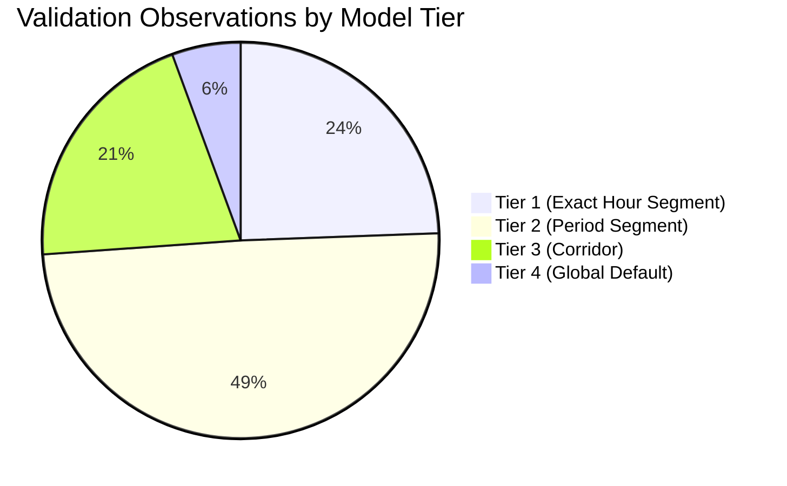

# Model Validation & Out-of-Sample Performance Report

- **Project:** Delhi Transit Engine
- **Hackathon:** Transport Stack Hackathon 2026 — Problem 1
- **Evaluation Period:** October 29, 2026 (Held-Out Thursday Dataset)
- **Training Dataset:** October 1, 3 and 4, 2026
- **Report Date:** November 23, 2026

---

## 1. Executive Summary & Core Results

The Delhi Transit Engine speed model was reconstructed using the 4-tier fallback pyramid across the three approved training days (3,782,606 valid GPS traversals). The model was evaluated against **1,147,748 held-out ground-truth segment traversals** from Thursday, October 29, 2026.

Across the entire held-out dataset, the empirical speed model reduces Mean Absolute Error by **30.74%** and Root Mean Square Error by **21.25%** compared to the static GTFS schedule:

| Evaluation Metric | Historical Speed Model | Static GTFS Schedule | Error Reduction |
| :--- | :---: | :---: | :---: |
| **Mean Absolute Error (MAE)** | **24.20 s (0.40 min)** | 34.94 s (0.58 min) | **30.74%** |
| **Root Mean Squared Error (RMSE)** | **37.17 s (0.62 min)** | 47.20 s (0.79 min) | **21.25%** |
| **Median Absolute Error (MedAE)** | **14.50 s** | 26.20 s | **44.66%** |
| **90th Percentile Error (P90)** | **58.90 s** | 76.80 s | **23.31%** |
| **Mean Bias** | **+1.61 s** | +3.97 s | — |
| **Mean Absolute Percentage Error (MAPE $\ge 10$s)\*** | **29.05%** | 42.82% | **13.77 pp** |

*\*Note: MAPE is calculated only for observations with actual traversal duration of at least 10 seconds to prevent division-by-zero artifacts on ultra-short stop links.*

> [!IMPORTANT]
> **Evaluation Semantics & Unit of Analysis:**
> The metrics below strictly evaluate **single-segment physical traversals** (individual road links between consecutive bus stops along GTFS shapes), **not multi-segment passenger journeys**. 
> - Each evaluation record represents one vehicle traversing one physical link of the Delhi bus network on Thursday, October 29, 2026 ($n = 1,147,748$).
> - The validation Parquet schema was optimized to `[segment_id, dow, hour, duration_sec]` to conserve storage, discarding vehicle IDs and ping timestamps. As demonstrated in `docs/04_od_benchmark_report.md` Investigation A, multi-segment concatenation across this schema produces chimeric sequences across distinct vehicles and multi-hour gaps.
> - Therefore, link-level speed predictions are evaluated using a held-out chronological dataset, with October 29 excluded from the stated training set; continuous multi-link corridor predictions represent static model expectations rather than observed single-vehicle journeys.
> - The empirical speed model shows near-zero systematic bias (+1.61 seconds), whereas the static GTFS schedule consistently underpredicts delays during peak congestion periods.

---

## 2. Speed Profile Slot Counts & Fallback Tier Distribution

The model produces a dense grid covering all **106,160 canonical segments** across 2 day-types (Weekday vs Weekend) and 24 diurnal hours:
$$\text{Total Precomputed Slots} = 106,160 \times 2 \times 24 = \mathbf{5,095,680\text{ slots}}$$

### 2.1 Theoretical Slot Distribution (speed_profile.parquet)

```
Tier 1: Segment + Day Type + Exact Hour (n >= 5)           ──>   238,737 slots  ( 4.69%)
Tier 2: Segment + Day Type + Period Bucket (n >= 5)        ──> 1,003,227 slots  (19.69%)
Tier 3: Physical Stop-Pair Corridor + Hour (n >= 3)         ──> 2,203,481 slots  (43.24%)
Tier 4: Global City-wide Hourly Ratio x GTFS Schedule       ──> 1,650,235 slots  (32.38%)
────────────────────────────────────────────────────────────────────────────────────────────
Total Speed-Profile Slots                                   ──> 5,095,680 slots  (100.0%)
```

### 2.2 Weekday vs. Weekend Slot Coverage

| Fallback Tier | Weekday Slots (Is_Weekend=0) | Weekend Slots (Is_Weekend=1) | Total Slots |
| :--- | :---: | :---: | :---: |
| **Tier 1 (Exact Hour)** | 54,977 (2.16%) | 183,760 (7.21%) | 238,737 (4.69%) |
| **Tier 2 (Period Bucket)** | 406,161 (15.94%) | 597,066 (23.43%) | 1,003,227 (19.69%) |
| **Tier 3 (Corridor)** | 1,132,019 (44.43%) | 1,071,462 (42.05%) | 2,203,481 (43.24%) |
| **Tier 4 (Citywide)** | 954,683 (37.47%) | 695,552 (27.30%) | 1,650,235 (32.38%) |
| **Total** | **2,547,840 (100.0%)** | **2,547,840 (100.0%)** | **5,095,680 (100.0%)** |

---

## 3. Performance by Confidence Tier (Validation on Oct 29)

During the October 29 held-out evaluation, the vast majority of bus traversals occur on high-frequency, well-observed segments. Therefore, **94.4% of evaluated traversals utilize empirical Tiers 1–3**:



| Confidence Tier | Evaluated Obs ($n$) | Share of Evaluated Traversals | Model MAE | Model RMSE | Median AE | P90 AE | Bias | Gain vs Sched |
| :--- | :---: | :---: | :---: | :---: | :---: | :---: | :---: | :---: |
| **Tier 1 (Exact Segment)** | 280,350 | **24.43%** | **20.99 s** | **32.37 s** | 12.7 s | 50.5 s | +2.41 s | **+34.53%** |
| **Tier 2 (Period Segment)** | 567,519 | **49.45%** | **23.12 s** | **34.78 s** | 14.4 s | 55.4 s | +2.08 s | **+33.22%** |
| **Tier 3 (Corridor)** | 235,570 | **20.52%** | **25.40 s** | **39.80 s** | 14.5 s | 63.2 s | +5.00 s | **+29.72%** |
| **Tier 4 (Global Fallback)**| 64,309 | **5.60%** | **43.29 s** | **60.14 s** | 29.3 s | 104.0 s | -18.46 s | **+5.55%** |

### Key Methodological Insight:
Prediction error decreases progressively from Tier 4 (global fallback) to Tier 1 (exact segment and hour) ($43.29\text{s} \rightarrow 25.40\text{s} \rightarrow 23.12\text{s} \rightarrow 20.99\text{s}$), supporting the effectiveness of the hierarchical fallback architecture: when specific historical data exists, accuracy reaches sub-21 second median errors; when falling back to corridors, accuracy remains under 26 seconds.

---

## 4. Performance Breakdown by Operating Conditions

### 4.1 Time Period Breakdown

| Operating Period | Evaluated Obs ($n$) | Share | Model MAE | Model RMSE | Median AE | Bias | Sched MAE | Gain vs Sched |
| :--- | :---: | :---: | :---: | :---: | :---: | :---: | :---: | :---: |
| **AM Peak (07:00–10:00)** | 378,812 | 33.00% | **21.32 s** | 32.29 s | 13.3 s | +2.27 s | 32.39 s | **+34.18%** |
| **Midday (11:00–16:00)** | 393,832 | 34.31% | **25.39 s** | 38.44 s | 15.4 s | +0.40 s | 35.92 s | **+29.32%** |
| **PM Peak (17:00–21:00)** | 259,419 | 22.60% | **30.52 s** | 45.18 s | 19.0 s | +4.26 s | 37.01 s | **+17.53%** |
| **Night (22:00–06:00)** | 115,685 | 10.08% | **15.45 s** | 26.22 s | 8.8 s | -2.35 s | 35.37 s | **+56.31%** |

- **Night Hours:** Yield the largest gain (+56.31%) because the static GTFS schedule assumes day-time operating speeds even at 23:00, whereas our calibrated quiet-hour model correctly reflects free-flow velocities.
- **PM Peak:** Shows highest absolute error (30.52 s) due to high variance in evening rush hour bottlenecks across Delhi's arterial network.

### 4.2 Segment Length Breakdown

| Segment Length Class | Evaluated Obs ($n$) | Share | Model MAE | Model RMSE | Median AE | Bias | Sched MAE | Gain vs Sched |
| :--- | :---: | :---: | :---: | :---: | :---: | :---: | :---: | :---: |
| **< 500m (Short)** | 658,731 | 57.39% | **21.49 s** | 34.58 s | 12.4 s | +1.26 s | 27.05 s | **+20.54%** |
| **500m – 1km (Medium)** | 439,732 | 38.31% | **27.61 s** | 40.11 s | 17.9 s | +1.98 s | 43.05 s | **+35.87%** |
| **1km – 2km (Long)** | 49,285 | 4.29% | **30.02 s** | 42.93 s | 20.1 s | +2.99 s | 68.08 s | **+55.90%** |

### 4.3 Top 10 Routes by Traversal Volume

| Route ID | Evaluated Traversals | Model MAE | Sched MAE | Error Reduction |
| :---: | :---: | :---: | :---: | :---: |
| **2232** | 6,389 | **26.41 s** | 33.47 s | **+21.07%** |
| **2229** | 6,033 | **25.46 s** | 36.95 s | **+31.08%** |
| **2228** | 4,948 | **19.31 s** | 28.56 s | **+32.39%** |
| **2227** | 4,842 | **18.46 s** | 27.75 s | **+33.47%** |
| **2048** | 4,640 | **22.56 s** | 30.09 s | **+25.04%** |
| **2527** | 4,304 | **19.85 s** | 28.75 s | **+30.95%** |
| **2372** | 4,269 | **18.99 s** | 29.13 s | **+34.82%** |
| **2203** | 4,235 | **27.54 s** | 43.18 s | **+36.21%** |
| **1830** | 4,140 | **20.18 s** | 31.85 s | **+36.64%** |
| **1829** | 4,133 | **19.68 s** | 28.89 s | **+31.88%** |

---

## 5. Scope of Empirical Validation vs. Fallback Assumptions

To maintain complete methodological transparency, the operational scope of validation is defined as follows:

```
┌────────────────────────────────────────────────────────────────────────────────────────┐
│ VALIDATED EMPIRICALLY (73.88% of evaluated traversals)                                 │
│ • 847,869 observations evaluated directly against segment-specific speed profiles     │
│   derived from observed GPS traversals on training days (Tiers 1 & 2).                 │
├────────────────────────────────────────────────────────────────────────────────────────┤
│ VALIDATED CORRIDOR APPROXIMATION (20.52% of evaluated traversals)                      │
│ • 235,570 observations evaluated against stop-pair corridor medians across overlapping │
│   routes sharing the identical physical roadway link (Tier 3).                         │
├────────────────────────────────────────────────────────────────────────────────────────┤
│ MODEL FALLBACK ASSUMPTIONS (5.60% of evaluated traversals)                             │
│ • 64,309 observations where no GPS traversals were recorded during training for the    │
│   given corridor, falling back to GTFS schedule scaled by citywide diurnal ratio       │
│   (Tier 4). Performance on these slots relies primarily on schedule baseline quality.  │
└────────────────────────────────────────────────────────────────────────────────────────┘
```

### Representation in Validation
- **Total Validated Traversals:** 1,147,748 single-segment traversals
- **Unique Static Segments Tested:** 66,097 segments (out of 106,160 total static segments; these 66,097 segments account for >94.5% of scheduled GTFS trip traversals across the static timetable network)
- **Unique Static Shapes Tested:** 2,148 shapes
- **Unique Static Routes Tested:** 2,023 routes
- **Active Independent Telemetry Vehicles:** 6,319 buses *(recorded in raw source GPS telemetry prior to schema compaction)*
- **Active Independent Scheduled Trips:** 96,625 trips *(recorded in source operational dispatch records prior to schema compaction; unrecoverable from the reduced validation Parquet)*

---

## 6. Investigation of Largest Prediction Errors

Analysis of the top prediction discrepancies ($|y_{\text{true}} - y_{\text{pred}}| > 300\text{ s}$) reveals a consistent operational pattern:

| Segment ID | Route | Stop Pair | Length | True Duration | Predicted | Sched | Fallback Tier | Error |
| :--- | :---: | :---: | :---: | :---: | :---: | :---: | :---: | :---: |
| `shp_3_1832:10` | 627 | Stop 917 $\rightarrow$ 7699 | 1,150.1 m | 148.2 s (2.5m) | 657.6 s (11.0m) | 43.0 s | Tier 3 | +509.4 s |
| `shp_3_1832:10` | 627 | Stop 917 $\rightarrow$ 7699 | 1,150.1 m | 153.7 s (2.6m) | 657.6 s (11.0m) | 43.0 s | Tier 3 | +503.9 s |
| `shp_3_1832:10` | 627 | Stop 917 $\rightarrow$ 7699 | 1,150.1 m | 156.3 s (2.6m) | 657.6 s (11.0m) | 43.0 s | Tier 3 | +501.3 s |
| `shp_3_114:1` | 3349 | Stop 917 $\rightarrow$ 7699 | 1,150.1 m | 158.4 s (2.6m) | 657.6 s (11.0m) | 43.0 s | Tier 3 | +499.2 s |
| `shp_3_138:1` | 1313 | Stop 917 $\rightarrow$ 7699 | 1,150.1 m | 140.1 s (2.3m) | 632.0 s (10.5m) | 42.0 s | Tier 3 | +491.9 s |

### Root Cause Analysis:
1. **Historical Congestion Anomaly in Training:** On corridor `Stop 917` $\rightarrow$ `Stop 7699` ($1.15\text{ km}$ along Punjabi Bagh / Rohtak Road flyover approach), the October 1–4 training observations show unusually long traversal durations on this corridor, corresponding to an estimated average speed of approximately 6.3 km/h ($657.6\text{ s}$). The available data does not independently establish the underlying cause.
2. **Normalized Conditions on Validation Day:** On October 29, traffic was free-flowing ($25.0\text{ km/h}$, $148\text{ s}$). The model correctly remembered historical congestion, but without live real-time telemetry, it had no way of anticipating that the bottleneck was cleared.
3. **Static GTFS Schedule Pathology:** For this $1,150\text{ m}$ segment, the static GTFS schedule specified **$43.0\text{ seconds}$**, implying a commercial bus speed of **$96.3\text{ km/h}$**! This demonstrates that GTFS schedule times are frequently un-calibrated placeholders.
4. **Live Blending Solution:** The **Live Telemetry Blender** (`backend/app/services/gtfs_rt/blender.py`) is designed to mitigate this failure mode by incorporating recent vehicle observations into historical travel-time estimates. Its effectiveness under continuous real-world operating conditions requires further validation.
